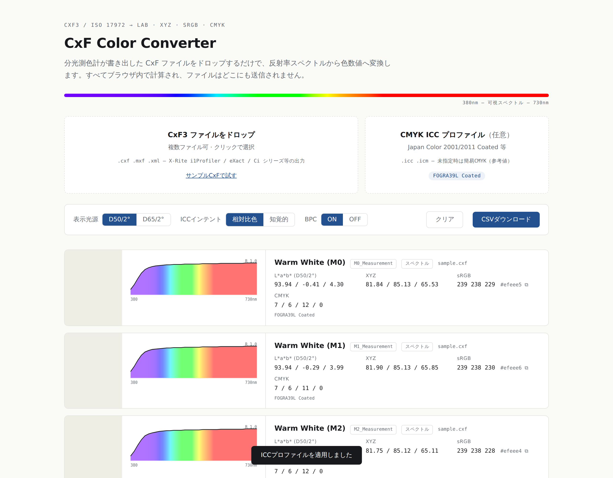

# CxF Color Converter

**CxF3 (ISO 17972) の分光測定データを、ブラウザだけで Lab / XYZ / sRGB / CMYK に変換する無料Webツール**

🔗 **https://daisukehori.github.io/cxf-color-converter/**

分光測色計（X-Rite i1Pro / eXact / Ci シリーズなど）が書き出す CxF ファイルをドロップするだけで、反射率スペクトルから色数値へ変換します。すべての計算はブラウザ内（JavaScript）で完結し、**ファイルはどこにも送信されません**。



## 特徴

- **CxF3 対応** — ISO 17972 / X-Rite CxF3-core 名前空間。M0 / M1 / M2 測定（ISO 13655）、`ReflectanceSpectrum`、`ColorCIELab` / `ColorCIEXYZ` / `ColorSRGB` 直接値、任意の波長レンジ（`WavelengthRange` の StartWL / Increment を自動解決）に対応
- **Lab / XYZ** — CIE 1931 2° 等色関数 × 標準イルミナント（D50 / D65 切替）で積分。テーブルは [colour-science](https://www.colour-science.org/) 由来の正確な値
- **sRGB** — Lab(D50) から Bradford 変換で D65 へ順応後、IEC 61966-2-1 行列で算出。色域外はクランプして明示
- **CMYK（ICC 高精度）** — 手元の CMYK ICC プロファイル（Japan Color 2001/2011 Coated 等）をドロップすると、[jsColorEngine](https://github.com/glennwilton/jsColorEngine)（lcms2 と ΔE≤0.06 の一致精度）で Lab→CMYK 変換。レンダリングインテント（相対比色 / 知覚的）と BPC を選択可能
- **CMYK（簡易）** — ICC 未指定時は sRGB からの数式変換による参考値を表示（バッジで明示）
- **スペクトル可視化** — 380–730nm の実波長色グラデーションで反射率カーブを描画
- **CSV エクスポート** — Lab / XYZ / sRGB / CMYK / 36点スペクトルを一括出力（Excel 対応 BOM 付き UTF-8）

## 使い方

1. https://daisukehori.github.io/cxf-color-converter/ を開く
2. CxF3 ファイル（.cxf / .mxf / .xml）をドロップ（複数可）
3. （任意）CMYK ICC プロファイル（.icc / .icm）をドロップ
4. 必要に応じて表示光源・インテント・BPC を切り替え、CSV でダウンロード

初めての方は「サンプルCxFで試す」ボタンでデモデータを読み込めます。

## Japan Color の ICC プロファイルについて

Japan Color 2011 の ICC プロファイルは、X-Rite 社が作成し日本印刷産業機械工業会が提供しているもので、ダウンロードにはライセンス契約への同意が必要です。そのため**本リポジトリには同梱していません**。以下から入手し、本ツールにドロップしてください。

- Japan Color 認証制度 ICC プロファイル: https://japancolor.jp/icc.html
- Adobe 製品付属の「Japan Color 2001 Coated」（Photoshop 等をお使いの場合、既にお手元にあります）

## 計算方法と精度

| 項目 | 内容 |
|---|---|
| 波長グリッド | 380–730nm / 10nm（36点）。異なるグリッドは線形補間・端点クランプで再サンプリング |
| 等色関数 | CIE 1931 2° 標準観測者（colour-science 0.4.7 由来） |
| イルミナント | D50 / D65 SPD（同上） |
| 白色点 | テーブル自己整合値（完全拡散反射面が L\*=100, a\*=b\*=0 になる CIE 15 の慣行） |
| Lab→sRGB | Bradford D50→D65 順応 + IEC 61966-2-1 行列 |
| ICC CMYK | jsColorEngine による ICC v2/v4 変換（PCS の仕様上、入力は常に D50 Lab） |
| 検証 | X-Rite i1Profiler 実出力ファイル + colour-science / lcms2 系リファレンス値で 27 件のユニットテスト |

10nm グリッドと 5nm/1nm グリッドの計算値には理論上の微差（多くの場合 ΔE2000 < 0.1）があります。測色器メーカー純正ソフトの表示値と小数点以下で異なる場合がありますが、実用上の色判断には十分な精度です。

## ローカルでの実行・テスト

静的サイトなので、クローンして `index.html` を開くだけで動きます（`fetch` を使うサンプル読込のみ、ローカルでは簡易サーバー推奨）。

```bash
git clone https://github.com/DaisukeHori/cxf-color-converter.git
cd cxf-color-converter
python3 -m http.server 8000   # → http://localhost:8000

# ユニットテスト (Node.js)
npm install
npm test
```

## リポジトリ構成

```
index.html            # UI（単一ページ）
js/colorlib.js        # 色科学: スペクトル→XYZ→Lab→sRGB、ΔE2000、簡易CMYK
js/cxf-parser.js      # CxF3 パーサー
vendor/               # jsColorEngine (MPL-2.0) ブラウザビルド
samples/sample.cxf    # デモ用合成データ
test/run-tests.js     # ユニットテスト
```

## ロードマップ

- [ ] **Pantone / DIC 近似色検索** — 色ライブラリはライセンス上同梱できないため、「手元のライブラリファイル（CxF/ACO等）を読み込んで ΔE 最小の色を検索する」方式で対応予定
- [ ] CxF に含まれる複数測定（ロット）の統計表示
- [ ] CxF3 書き出し（Lab 手入力 → CxF 生成）

## 謝辞・由来

本ツールの変換ロジックは [iroca-color-simulator](https://github.com/DaisukeHori/iroca-color-simulator) の `measure.html` 内実装（`parseCxF3` / `specToLab` / `labToSrgb`）を抽出・汎用化したものです。CIE テーブルは colour-science プロジェクトの値で再検証しています。

## ライセンス

- 本体: [MIT License](LICENSE)
- `vendor/jsColorEngineWeb.js`: [MPL-2.0](vendor/jsColorEngineWeb.js.LICENSE.txt)（© Glenn Wilton — [jsColorEngine](https://github.com/glennwilton/jsColorEngine)）

CxF® は X-Rite, Incorporated の登録商標です。本ツールは X-Rite 社とは無関係の個人プロジェクトです。
